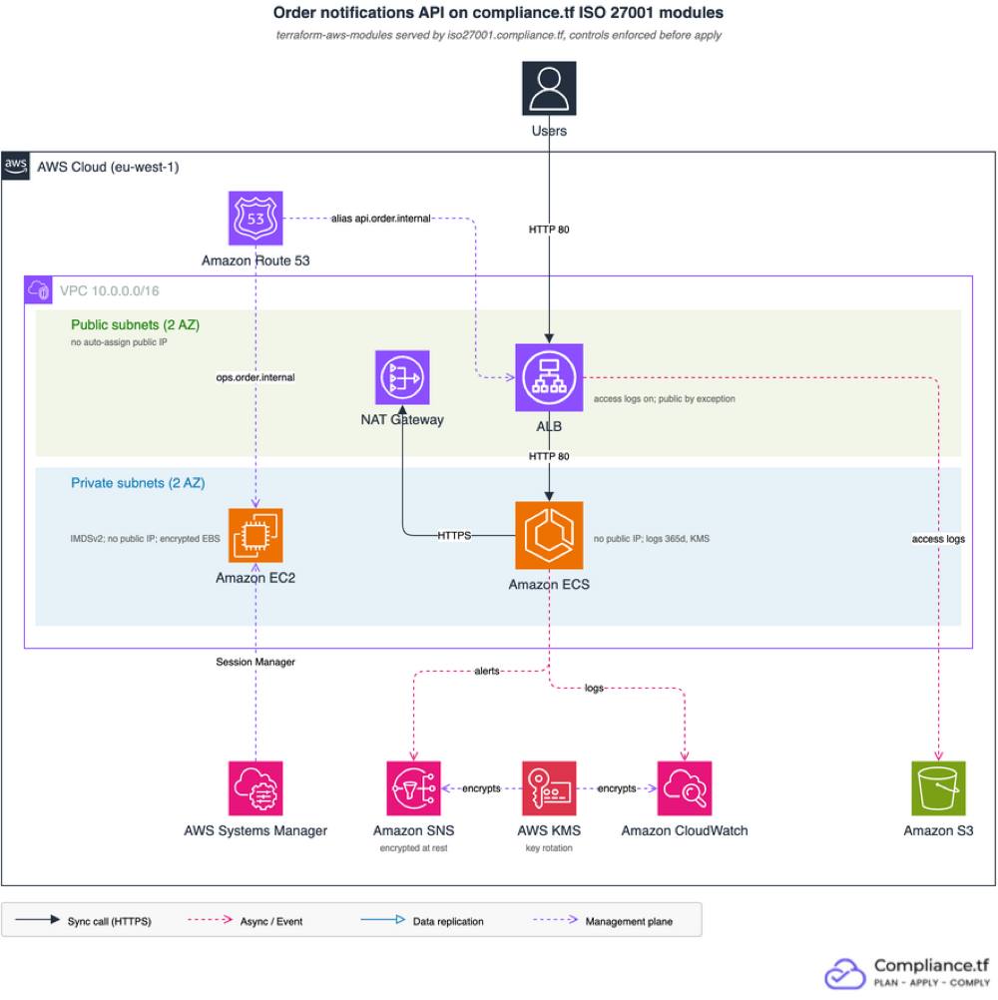

# compliance.tf demo: ISO 27001 modules on AWS

A small internet-facing API built only from [terraform-aws-modules](https://github.com/terraform-aws-modules), served by [compliance.tf](https://compliance.tf) from the ISO/IEC 27001:2022 endpoint `iso27001.compliance.tf`. The same modules, inputs and outputs, with the framework's controls enforced before `terraform apply`.



Users post order events to an ALB. An ECS Fargate service in private subnets handles them, logs to CloudWatch and sends alerts to SNS. An ops host is reachable only through SSM Session Manager. One KMS key encrypts logs and alerts. Route 53 serves the private zone `order.internal`.

Modules: `vpc` 6.7.3, `kms` 4.2.2, `sns` 7.2.0, `ecs` 7.6.1, `alb` 10.5.1, `ec2-instance` 6.4.1, `route53` 6.5.1.

## How it relates to ISO 27001

Enforced means the module refuses an insecure value at plan time and names the control. The Annex A column is our reading of where each control helps; it is not a certification claim. The ISO 27001 framework page lists which controls compliance.tf enforces and which another system has to cover: https://compliance.tf/docs/frameworks/aws/iso_27001_2022/

| Area | Enforced control (module) | Annex A theme |
|---|---|---|
| Cryptography | `kms_cmk_rotation_enabled` (kms), `sns_topic_encrypted_at_rest` (sns), `log_group_encryption_at_rest_enabled` (ecs) | A.8.24 Use of cryptography |
| Logging | `cloudwatch_log_group_retention_period_365` (ecs), `elb_application_classic_lb_logging_enabled` (alb) | A.8.15 Logging |
| Network | `vpc_subnet_auto_assign_public_ip_disabled`, `vpc_block_public_access_restrict_internet_gateway_traffic` (vpc), `ecs_service_not_publicly_accessible` (ecs) | A.8.20 Networks security, A.8.22 Segregation of networks |
| Hosts | `ec2_instance_uses_imdsv2`, `ec2_instance_not_publicly_accessible`, `ec2_instance_iam_profile_attached` (ec2-instance) | A.8.9 Configuration management |
| Change | every change goes through a pull request with `terraform plan` and ctfkit checks | A.8.32 Change management |

Route 53 has no enforced ISO 27001 control. It stays in the demo to show that gaps are listed, not hidden.

### Exception

The ALB is public by design, so `elb_application_classic_network_lb_prohibit_public_access` is switched off on that one module (`?disable=` in its source) and recorded in [.github/ctfkit/exceptions.yaml](.github/ctfkit/exceptions.yaml) with an owner and a review date. Compensating controls: access logs on, only port 80/443 open, targets in private subnets.

## Controls report

Generated by [ctfkit](https://github.com/compliancetf/ctfkit) from the module manifests after `terraform init`, and updated on every push to `master` by [readme-report.yml](.github/workflows/readme-report.yml).

<!-- CTFKIT_REPORT_START -->
## Compliance coverage

Generated by ctfkit report (stage post_init) for `infra` at 2026-11-09T17:47:14Z, run `42667895489` on github-actions, commit `4e9acdfa526eac74f68bd69186c3c81f2f57315c`.

### alb - iso27001.compliance.tf/terraform-aws-modules/alb/aws 10.5.1-8e4829f4cf3ee1c5 - 4 enforced, 0 delegated, 157 not applicable

| Control | Requirement enforced | Satisfied in | ISO/IEC 27001:2022 |
|---|---|---|---|
| elb_application_classic_lb_logging_enabled | ELB application and classic load balancer logging should be enabled | alb | A.8.15 |
| vpc_security_group_allows_ingress_to_cassandra_ports | VPC security groups should restrict ingress from 0.0.0.0/0 or ::/0 to cassandra ports 7199 or 9160 or 8888 | alb |  |
| vpc_security_group_remote_administration_ipv4 | VPC security groups should not allow ingress from 0.0.0.0/0 to remote server administration ports (IPv4) | alb |  |
| vpc_security_group_remote_administration_ipv6 | VPC security groups should not allow ingress from ::/0 to remote server administration ports | alb |  |

### ops - iso27001.compliance.tf/terraform-aws-modules/ec2-instance/aws 6.4.1-abf3d572fa28350a - 9 enforced, 0 delegated, 153 not applicable

| Control | Requirement enforced | Satisfied in | ISO/IEC 27001:2022 |
|---|---|---|---|
| ebs_attached_volume_encryption_enabled | Attached EBS volumes should have encryption enabled | ops | A.8.24 |
| ec2_instance_iam_profile_attached | EC2 instances should have IAM profile attached | ops | A.8.2, A.8.20, A.8.21, A.8.22 |
| ec2_instance_not_publicly_accessible | EC2 instances should not have a public IP address | ops | A.8.3, A.8.20, A.8.21, A.8.22 |
| ec2_instance_not_use_multiple_enis | EC2 instances should not use multiple ENIs | ops | A.8.20, A.8.21, A.8.22 |
| ec2_instance_uses_imdsv2 | EC2 instances should use IMDSv2 | ops | A.8.20, A.8.21, A.8.22 |
| ec2_instance_virtualization_type_no_paravirtual | EC2 instances should not use paravirtual instance types | ops | A.8.20, A.8.21, A.8.22 |
| vpc_security_group_allows_ingress_to_cassandra_ports | VPC security groups should restrict ingress from 0.0.0.0/0 or ::/0 to cassandra ports 7199 or 9160 or 8888 | ops |  |
| vpc_security_group_remote_administration_ipv4 | VPC security groups should not allow ingress from 0.0.0.0/0 to remote server administration ports (IPv4) | ops |  |
| vpc_security_group_remote_administration_ipv6 | VPC security groups should not allow ingress from ::/0 to remote server administration ports | ops |  |

### ecs, ecs.cluster, ecs.service, ecs.service.container_definition - iso27001.compliance.tf/terraform-aws-modules/ecs/aws 7.6.1-abf3d572fa28350a - 6 enforced, 0 delegated, 156 not applicable

| Control | Requirement enforced | Satisfied in | ISO/IEC 27001:2022 |
|---|---|---|---|
| cloudwatch_log_group_retention_period_365 | CloudWatch log groups should have retention period of at least 365 days | ecs, ecs.cluster, ecs.service.container_definition | A.8.15, A.8.16 |
| ecs_service_not_publicly_accessible | ECS services should not have public IP addresses assigned automatically | ecs.service | A.8.3 |
| log_group_encryption_at_rest_enabled | Log groups should have encryption at rest enabled | ecs.cluster, ecs.service.container_definition | A.8.15, A.8.16, A.8.24 |
| vpc_security_group_allows_ingress_to_cassandra_ports | VPC security groups should restrict ingress from 0.0.0.0/0 or ::/0 to cassandra ports 7199 or 9160 or 8888 | ecs.cluster, ecs.service |  |
| vpc_security_group_remote_administration_ipv4 | VPC security groups should not allow ingress from 0.0.0.0/0 to remote server administration ports (IPv4) | ecs.cluster, ecs.service |  |
| vpc_security_group_remote_administration_ipv6 | VPC security groups should not allow ingress from ::/0 to remote server administration ports | ecs.cluster, ecs.service |  |

### kms - iso27001.compliance.tf/terraform-aws-modules/kms/aws 4.2.2-abf3d572fa28350a - 1 enforced, 0 delegated, 161 not applicable

| Control | Requirement enforced | Satisfied in | ISO/IEC 27001:2022 |
|---|---|---|---|
| kms_cmk_rotation_enabled | KMS CMK rotation should be enabled | kms | A.8.5, A.8.24 |

### zone - iso27001.compliance.tf/terraform-aws-modules/route53/aws 6.5.1-abf3d572fa28350a - 0 enforced, 3 delegated, 159 not applicable

| Control | Requirement enforced | Satisfied in | ISO/IEC 27001:2022 |
|---|---|---|---|
| vpc_security_group_allows_ingress_to_cassandra_ports | VPC security groups should restrict ingress from 0.0.0.0/0 or ::/0 to cassandra ports 7199 or 9160 or 8888 | delegated, not in this configuration |  |
| vpc_security_group_remote_administration_ipv4 | VPC security groups should not allow ingress from 0.0.0.0/0 to remote server administration ports (IPv4) | delegated, not in this configuration |  |
| vpc_security_group_remote_administration_ipv6 | VPC security groups should not allow ingress from ::/0 to remote server administration ports | delegated, not in this configuration |  |

### sns - iso27001.compliance.tf/terraform-aws-modules/sns/aws 7.2.0-abf3d572fa28350a - 1 enforced, 0 delegated, 161 not applicable

| Control | Requirement enforced | Satisfied in | ISO/IEC 27001:2022 |
|---|---|---|---|
| sns_topic_encrypted_at_rest | SNS topics should be encrypted at rest | sns | A.8.24 |

### vpc - iso27001.compliance.tf/terraform-aws-modules/vpc/aws 6.7.3-abf3d572fa28350a - 6 enforced, 0 delegated, 156 not applicable

| Control | Requirement enforced | Satisfied in | ISO/IEC 27001:2022 |
|---|---|---|---|
| cloudwatch_log_group_retention_period_365 | CloudWatch log groups should have retention period of at least 365 days | vpc | A.8.15, A.8.16 |
| log_group_encryption_at_rest_enabled | Log groups should have encryption at rest enabled | vpc | A.8.15, A.8.16, A.8.24 |
| vpc_block_public_access_restrict_internet_gateway_traffic | EC2 VPC Block Public Access settings should block internet gateway traffic | vpc | A.8.3 (supporting) |
| vpc_security_group_remote_administration_ipv4 | VPC security groups should not allow ingress from 0.0.0.0/0 to remote server administration ports (IPv4) | vpc |  |
| vpc_security_group_remote_administration_ipv6 | VPC security groups should not allow ingress from ::/0 to remote server administration ports | vpc |  |
| vpc_subnet_auto_assign_public_ip_disabled | VPC subnet auto assign public IP should be disabled | vpc | A.8.20, A.8.21, A.8.22 |

A clause marked (supporting) is partial or indirect evidence for that clause, not full enforcement of it.

### Instances without a manifest

These are listed as not-evidence. They are not covered by this report.

- `zone.route53_dnssec_kms` (registry.terraform.io/terraform-aws-modules/kms/aws)

### Resources declared by this configuration

7 resource block(s), unattested: no imported test run covers them.

### Findings

| Level | Rule | Detail |
|---|---|---|
| error | `ctf.coverage.manifest_missing` | Module instance zone.route53_dnssec_kms (registry.terraform.io/terraform-aws-modules/kms/aws) has no compliancetf-manifest.json; it is listed as not-evidence, never as covered |
| error | `ctf.exec.module_endpoint` | Module module.zone.module.route53_dnssec_kms is installed from registry.terraform.io/terraform-aws-modules/kms/aws, which is not an allowed module endpoint; its code runs when this configuration is planned and applied |
| warning | `ctf.coverage.delegation_unresolved` | Control vpc_security_group_allows_ingress_to_cassandra_ports is delegated to scope modules/resolver-endpoint of iso27001.compliance.tf/terraform-aws-modules/route53/aws 6.5.1-abf3d572fa28350a; no instantiated module instance governs that scope, so this configuration has no evidence the control is enforced; the control catalog 2026.11.1 does not hold this control id (the embedded catalog holds the CIS v6.0 controls only; name a full catalog with --catalog), so the finding carries no control id |
| warning | `ctf.coverage.delegation_unresolved` | Control vpc_security_group_remote_administration_ipv4 is delegated to scope modules/resolver-endpoint of iso27001.compliance.tf/terraform-aws-modules/route53/aws 6.5.1-abf3d572fa28350a; no instantiated module instance governs that scope, so this configuration has no evidence the control is enforced |
| warning | `ctf.coverage.delegation_unresolved` | Control vpc_security_group_remote_administration_ipv6 is delegated to scope modules/resolver-endpoint of iso27001.compliance.tf/terraform-aws-modules/route53/aws 6.5.1-abf3d572fa28350a; no instantiated module instance governs that scope, so this configuration has no evidence the control is enforced |
| note | `ctf.coverage.resource_unattested` | This configuration declares 7 resource block(s) of its own and no imported test run covers them; they are unattested, not enforced |

### Consumer obligations

- `child_not_self_validating`: Must resolve package_manifest, confirm this scope_path is in that root's transitive child set, then verify manifest_set_hash.
- `delegated_controls_enforced_elsewhere`: Must not report a delegated control as enforced by this scope's files; must resolve the applies_in scope's manifest for the enforcement evidence.
- `evaluation_record_partial`: Must not read an empty subtree controls[] as coverage; must not read controls[] together with controls_not_applicable[] as the requested framework set.
- `no_evaluation_record`: Must not read an empty controls[] as coverage.
- `no_per_rule_attribution`: Must not attribute those files to any listed control.
- `ongoing_operation`: Must monitor deployed state independently of this document.
- `organizational_controls`: Must evidence organizational and process controls separately.
- `rules_are_package_scoped`: Must not report rules as scope-local.
- `runtime_state`: Must verify runtime state with AWS Config or Audit Manager.

Verdict: fail.
<!-- CTFKIT_REPORT_END -->

## Demo flow

| Step | Branch | What you see |
|---|---|---|
| 1 | `baseline` | The app on upstream `terraform-aws-modules` sources with a few insecure inputs, applied in advance. `ctfkit scan` lists every module source outside compliance.tf. |
| 2 | `demo/iso27001`, commit 1 | Only the source lines change to `iso27001.compliance.tf`. `terraform plan` fails with one `Control '<id>'` error per insecure input, each with its fix. |
| 3 | `demo/iso27001`, commit 2 | The insecure lines are deleted. The plan is clean: settings change in place, nothing is created or destroyed. |
| 4 | `demo/log-retention-exception` | The ECS module switches off `cloudwatch_log_group_retention_period_365` for a dev cost reason. ctfkit flags the disabled control by name; recording it in `.github/ctfkit/exceptions.yaml` (code owner review) clears the check. |

`master` is the end state: ISO 27001 sources, secure inputs, one recorded exception.
[DEMO.md](DEMO.md) has the commands for each step.

## Run it

Create in advance:

1. A dedicated AWS account and a local profile `demo`. VPC Block Public Access is set for the whole region in that account.
2. A compliance.tf token with ISO 27001 access ([free trial](https://compliance.tf/free-trial)): `export CTF_REGISTRY_TOKEN=...`
3. Tools: `terraform` >= 1.10, `aws`, `jq`, `gh`, [`ctfkit`](https://github.com/compliancetf/ctfkit) (`brew install compliancetf/tap/ctfkit`).
4. `make bootstrap`: creates the state bucket and the read-only GitHub OIDC plan role, and writes `infra/backend.hcl`.
5. In the GitHub repo: variables `AWS_REGION`, `AWS_PLAN_ROLE_ARN` and `TF_STATE_BUCKET` (from the bootstrap outputs); secret `CTF_REGISTRY_TOKEN`; branch protection on `master` requiring the checks `ctfkit scan` and `terraform plan`, with code owner review; allow `github-actions[bot]` to push the README report.

Then:

```sh
make login             # writes a local .netrc for HTTPS module sources
make baseline-branch   # upstream sources + insecure inputs on branch baseline
make apply-baseline    # about 5 minutes
make scan-baseline     # push baseline and run the CI scan on it (Security tab alerts)
make verify            # on master: plan is clean, 0 to add, 0 to destroy
make verify-fail       # the insecure variant fails with the expected control ids
make demo-pr           # step 2
make demo-fix          # step 3
make exception-pr      # step 4
make destroy           # afterwards; about $2 a day while running
```

`make help` lists every target.

## CI

[terraform.yml](.github/workflows/terraform.yml) runs on every pull request:

- `ctfkit scan` checks the configuration without `terraform init` or AWS credentials. It uses the registry token only to download the full control catalog: the catalog built into ctfkit holds the CIS v6.0 controls only, and the exceptions name ISO 27001 controls.
- `terraform plan` assumes the read-only role through OIDC, plans with `-lock=false`, scans the plan and posts one comment with the result.

Nothing is applied from CI. Jobs run on self-hosted runners and skip pull requests from forks.

### Security tab

Both scans upload their findings as SARIF to GitHub code scanning, each under its own category: `ctfkit/pre_plan` for the configuration scan and `ctfkit/post_plan` for the plan scan. On a pull request the findings show in the pull request's checks and as annotations on the diff. On `master` they become the repository's alerts on the [Security tab](https://github.com/compliancetf/demo/security/code-scanning), which GitHub shows only to people with write access.

Each alert carries:

- the rule name and family as filter tags (`coverage`, `policy`, ...)
- a severity badge: ctfkit errors show as high, warnings as medium, notes as low
- a help panel with what the rule reports, how to record an exception for it, and a link to the [analyzer reference](https://compliance.tf/docs/ctfkit/analyzers/)
- in the message, the compliance.tf module source that would close the gap, where there is one

A finding covered by an entry in [.github/ctfkit/exceptions.yaml](.github/ctfkit/exceptions.yaml) is not uploaded: code scanning ignores the SARIF suppression and would show it as an open alert. It stays in the job summary as suppressed. On `master` today both scans pass and every finding is covered by an exception, so the Security tab has no open alerts. Branch `baseline` (step 1 of the demo flow) has the [open alerts](https://github.com/compliancetf/demo/security/code-scanning?query=is%3Aopen+branch%3Abaseline): one `ctf.coverage.module_source` alert per upstream module source. A push to `baseline` does not run CI; `make scan-baseline` runs the configuration scan there. The plan job does not run on that branch, because the plan role trusts only pull requests and `master`. The `demo/iso27001` pull request switches those sources to compliance.tf, and its code scanning check reports no new alerts.

The coverage report stays in the pull request comment and the job summary.

Code scanning is free on public repositories. A private copy of this repository needs GitHub Code Security for the upload to work.

## What this does not prove

The checks run on configuration and plans. They do not watch the live account, so keep your CSPM or AWS Config for drift and console changes. Controls marked mapped-only on the framework page need another control.
